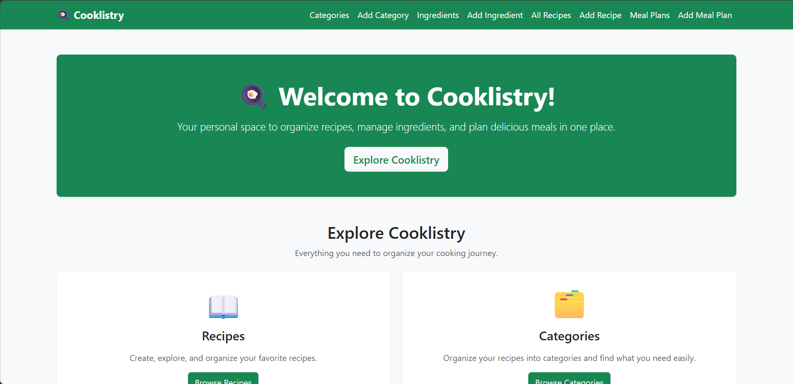
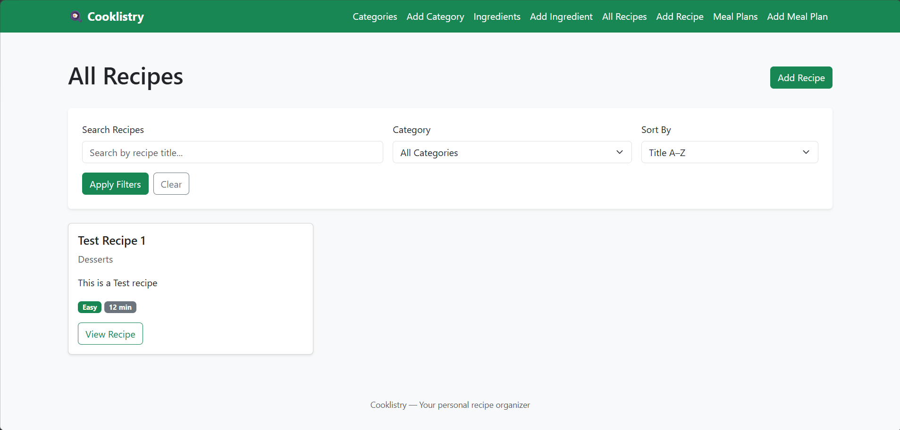
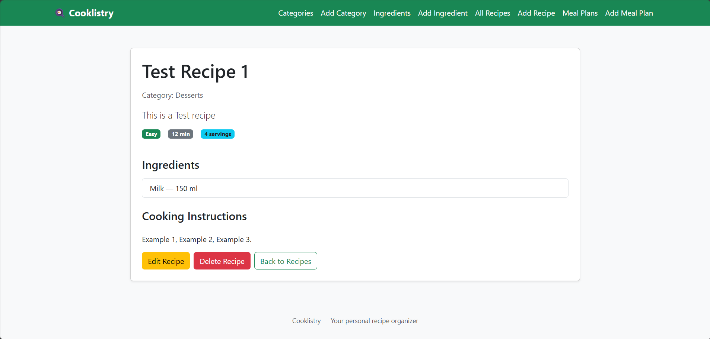
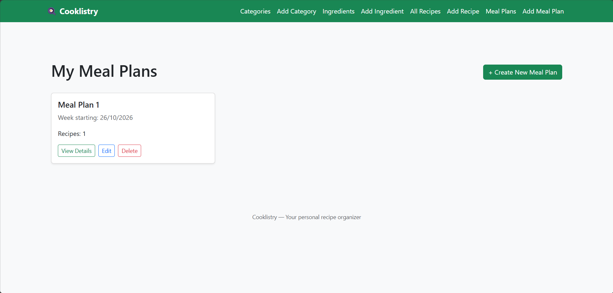

# 🍳 Cooklistry

### Your Personal Recipe Organizer & Meal Planner

Cooklistry is a Django web application designed to help
users organize their favorite recipes, manage ingredients,
and plan meals in one convenient place.

The project combines recipe management with meal planning,
making everyday cooking more organized and enjoyable.

## Project Overview

Cooklistry was developed as an individual project for the
SoftUni Python Web - Django Basics course.

The application allows users to create and organize recipes,
manage recipe categories and ingredients, and prepare meal
plans through a simple and user-friendly interface.

## Technologies Used

Cooklistry is built using the following technologies:

- **Python 3.11** — Main programming language.
- **Django 5.2** — Web framework for application logic, database models, forms, and templates.
- **PostgreSQL** — Relational database for storing recipes, ingredients, categories, and meal plans.
- **HTML5 & CSS3** — Structure and styling of the web pages.
- **Bootstrap 5** — Responsive layout and user interface components.
- **Django Template Language (DTL)** — Dynamic rendering, template inheritance, and reusable components.
- **Git & GitHub** — Version control and source code hosting.

## Features

Cooklistry provides the following features:

### Recipe Management
- Create, view, edit, and delete recipes.
- Organize recipes into categories.
- Assign multiple ingredients to recipes.
- Browse recipes through a reusable recipe card layout.
- Filter and sort recipes to find relevant results.

### Category Management
- Create, view, edit, and delete recipe categories.
- Use categories to organize recipes.

### Ingredient Management
- Create, view, edit, and delete ingredients.
- Reuse ingredients across multiple recipes.

### Meal Planning
- Create, view, edit, and delete meal plans.
- Associate recipes with meal plans.
- Organize planned meals using the application's interface.

### Additional Functionality
- Custom form validation with user-friendly error messages.
- Confirmation pages before deleting objects.
- Read-only and disabled form fields where appropriate.
- Custom Django template filters.
- Reusable templates and template inheritance.
- Custom 404 error page.
- Responsive navigation and layout using Bootstrap 5.

## Project Structure

Cooklistry is organized into three Django applications, each responsible for a specific part of the system.

| Django App | Responsibility |
|---|---|
| `recipes` | Manages recipes and recipe categories, including their creation, editing, viewing, and deletion. |
| `ingredients` | Manages ingredients that can be associated with recipes. |
| `meal_plans` | Manages meal plans and their associated recipes. |

### Main Project Components

- **`cooklistry/`** — Main Django project configuration, including settings and URL routing.
- **`recipes/`** — Recipe and category models, forms, views, and URL patterns.
- **`ingredients/`** — Ingredient models, forms, views, and URL patterns.
- **`meal_plans/`** — Meal planning models, forms, views, and URL patterns.
- **`templates/`** — HTML templates, including reusable components and the custom 404 page.
- **`manage.py`** — Django command-line utility.
- **`requirements.txt`** — Python dependencies.
- **`.env.example`** — Example environment configuration without real credentials.

## Prerequisites

Before installing and running Cooklistry, make sure the following software is available:

- **Python 3.11 or a compatible version** — Required to run the Django application.
- **PostgreSQL** — Database server used to store application data.
- **Git** — Required to clone the project repository.
- **pip** — Python package manager for installing dependencies.

The application uses a Python virtual environment to keep project dependencies isolated from the system's global Python installation.

No user registration, login, or authentication is required to use Cooklistry.

## Installation & Setup

Follow these steps to install Cooklistry locally.

### 1. Clone the Repository

Open a terminal and clone the project from GitHub:

```bash
git clone https://github.com/stoyanova-mariela/django_cooklistry.git
cd django_cooklistry
```

### 2. Create a Virtual Environment

Create an isolated Python environment:

```bash
python -m venv .venv
```

Activate the virtual environment.

**Windows (PowerShell):**

```powershell
.\.venv\Scripts\Activate.ps1
```

**macOS / Linux:**

```bash
source .venv/bin/activate
```

### 3. Install Dependencies

Install the required Python packages:

```bash
python -m pip install -r requirements.txt
```

This command installs Django and the additional packages required by Cooklistry, as listed in `requirements.txt`.

### 4. PostgreSQL Database Setup

Cooklistry uses PostgreSQL as its database management system.

Before running the application, make sure PostgreSQL is installed and the database server is running.

Create a new, empty PostgreSQL database named `cooklistry_db`.

You can use **pgAdmin** or the PostgreSQL command-line tool (`psql`).

Using `psql`, connect with a PostgreSQL account that has permission to create databases:

```bash
psql -U postgres
```

Then execute:

```sql
CREATE DATABASE cooklistry_db;
```

Exit PostgreSQL:

```sql
\q
```

The database should initially be empty. Django will create the required database tables when migrations are applied.

Make sure the PostgreSQL account configured in the `.env` file has permission to connect to and create tables in this database.

### 5. Environment Configuration

Cooklistry uses environment variables to keep database credentials and Django configuration separate from the source code.

An example configuration file, `.env.example`, is included in the repository.

**Create your local `.env` file:**

Windows (PowerShell):

```powershell
Copy-Item .env.example .env
```

macOS / Linux:

```bash
cp .env.example .env
```

Open the newly created `.env` file and configure the following variables:

```dotenv
DB_NAME=cooklistry_db
DB_USER=your_postgres_user_here
DB_PASSWORD=your_postgres_password_here
DB_HOST=localhost
DB_PORT=5432

DJANGO_DEBUG=True
DJANGO_SECRET_KEY=replace_with_your_own_generated_secret_key
```

**Environment variables explained:**

| Variable | Description |
|---|---|
| `DB_NAME` | Name of the PostgreSQL database. |
| `DB_USER` | PostgreSQL username with access to the database. |
| `DB_PASSWORD` | Password for the PostgreSQL account. |
| `DB_HOST` | Database server hostname. |
| `DB_PORT` | PostgreSQL server port (default: 5432). |
| `DJANGO_DEBUG` | Enables detailed error pages during local development. |
| `DJANGO_SECRET_KEY` | Secret key required by Django. |

Generate a Django secret key using:

```powershell
python -c "from django.core.management.utils import get_random_secret_key; print(get_random_secret_key())"
```

Copy the generated value into `DJANGO_SECRET_KEY` in the `.env` file.

**Security notes:**

- Never commit the `.env` file to GitHub.
- Do not publish real database passwords or Django secret keys.
- Use `DJANGO_DEBUG=True` only for local development and testing.
- Set `DJANGO_DEBUG=False` outside the development environment.

The application loads the `.env` file automatically through `python-dotenv`.

### 6. Apply Database Migrations

After configuring PostgreSQL and the `.env` file, apply the existing Django migrations:

```bash
python manage.py migrate
```

This command creates the database tables required by the application.

The database does not need any prepopulated data, fixtures, or custom initialization scripts.

All categories, ingredients, recipes, and meal plans can be created manually through the application's user interface.

### 7. Run the Development Server

Start the Django development server:

```bash
python manage.py runserver
```

After the server starts successfully, open your browser and navigate to:

**http://127.0.0.1:8000/**

The Cooklistry homepage should be displayed.

Use the navigation menu to access recipe categories, ingredients, recipes, and meal plans.

No login or user registration is required.

## How to Use Cooklistry

Cooklistry is designed to be used directly through its navigation menu, without requiring authentication.

### Getting Started with an Empty Database

Follow these steps to create your first meal plan:

1. **Create a Category**
   - Open **Add Category** from the navigation menu.
   - Enter a category name and the required details.
   - Save the category.

2. **Add Ingredients**
   - Open **Add Ingredient** from the navigation menu.
   - Create one or more ingredients.
   - Save each ingredient.

3. **Create a Recipe**
   - Open **Add Recipe** from the navigation menu.
   - Fill in the recipe details.
   - Select a category and the relevant ingredients.
   - Save the recipe.

4. **Create a Meal Plan**
   - Open **Add Meal Plan** from the navigation menu.
   - Enter the meal plan details.
   - Associate the plan with existing recipes.
   - Save the meal plan.

5. **Explore and Manage Your Data**
   - Browse categories, ingredients, recipes, and meal plans.
   - Open individual records to view their details.
   - Edit or delete records using the available actions.
   - Use recipe filtering and sorting to find specific recipes.

All required objects can be created through the application interface. No Django admin access, fixtures, or manual database manipulation is necessary.

## Testing & Validation

Cooklistry can be tested manually through its web interface.

### Database and Application Checks

After completing the installation and database configuration, run:

```bash
python manage.py check
python manage.py migrate
python manage.py runserver
```

The application should start without configuration errors.

### Functional Testing

The following checklist can be used to verify the application:

- [ ] Open the homepage and navigate to all main sections.
- [ ] Create a category through the interface.
- [ ] Create one or more ingredients.
- [ ] Create a recipe associated with a category and ingredients.
- [ ] Create a meal plan using existing recipes.
- [ ] View individual object details.
- [ ] Edit existing records and verify that changes are saved.
- [ ] Delete an object after confirming the deletion.
- [ ] Test recipe filtering and sorting.
- [ ] Submit invalid form data and verify that meaningful validation messages appear.
- [ ] Verify that the disabled form field cannot be edited.
- [ ] Open a nonexistent URL and verify that the custom 404 page appears when `DJANGO_DEBUG=False`.

### Empty Database Verification

The application is designed to work without preloaded data. After applying migrations to a new, empty PostgreSQL database, all required objects should be creatable through the navigation menu.

No fixtures, custom data initialization scripts, or Django admin operations are required.

## Screenshots

The following screenshots showcase the Cooklistry user interface and its main features.

### Homepage



### Recipe List



### Recipe Details



### Meal Plans



## Author & Credits

**Developed by:** Mariela Stoyanova

**Project:** Cooklistry — Personal Recipe Organizer & Meal Planner

**Course:** Python Web — Django Basics, SoftUni (September 2026)

**GitHub Repository:** https://github.com/stoyanova-mariela/django_cooklistry

Cooklistry is an individual educational project developed to demonstrate Django models, forms, views, templates, database relationships, and CRUD functionality.